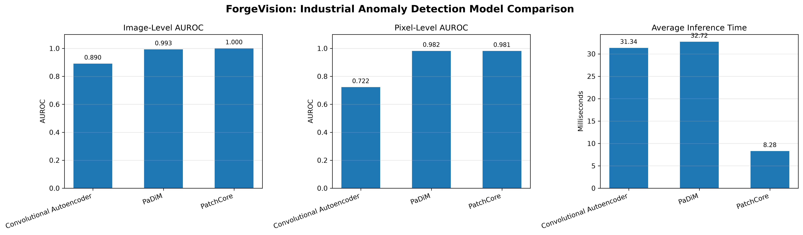
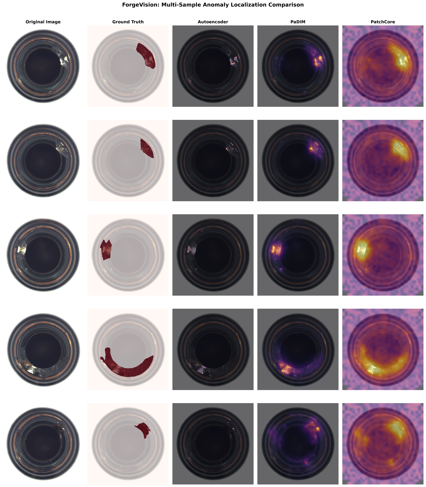

# ForgeVision
### AI-Powered Industrial Defect Detection Using Unsupervised Anomaly Detection

ForgeVision is a computer vision project that detects industrial product defects using deep learning-based anomaly detection. It compares three approaches ” **Convolutional Autoencoder, PaDiM, and PatchCore** ” using only defect-free images for model training.

The system identifies anomalous products at the image level and generates pixel-level anomaly maps to highlight potentially defective regions. A Streamlit application provides an interactive interface for testing images.

---

## Key Features

- Unsupervised anomaly detection trained exclusively on defect-free images.
- Three anomaly detection approaches implemented and evaluated.
- Image-level defect classification.
- Pixel-level anomaly localization using heatmaps.
- Threshold calibration using a separate normal-image calibration set.
- Quantitative model comparison using image AUROC, pixel AUROC, and inference time.
- Interactive Streamlit application for image analysis.
- GPU-accelerated inference using PyTorch and CUDA.

## Models Implemented

| Model | Approach | Main Technique |
|---|---|---|
| Convolutional Autoencoder | Reconstruction-based | Detects anomalies through reconstruction error |
| PaDiM | Feature distribution-based | Models multivariate Gaussian distributions of pretrained CNN features |
| PatchCore | Memory-bank-based | Compares test-image patches against a representative normal feature memory bank |

### 1. Convolutional Autoencoder

A convolutional encoder-decoder network learns to reconstruct normal product images. Reconstruction errors are used as anomaly scores, with larger errors indicating potentially defective regions.

### 2. PaDiM

PaDiM (Patch Distribution Modeling) extracts pretrained ResNet18 features and models their spatial distributions using multivariate Gaussian distributions. Mahalanobis distance is used to generate anomaly maps.

### 3. PatchCore

PatchCore extracts local feature representations using ResNet18 and constructs a representative memory bank of normal image patches through greedy coreset selection. Anomaly scores are calculated using nearest-neighbor distances.

---

## Dataset

**Dataset:** MVTec Anomaly Detection (MVTec AD)
**Category:** Bottle
**Image resolution:** 256 × 256 pixels after preprocessing.

The project uses a Hugging Face mirror of the MVTec AD dataset:

- Dataset repository: [Voxel51/mvtec-ad](https://huggingface.co/datasets/Voxel51/mvtec-ad)
- Original dataset: [MVTec Anomaly Detection](https://www.mvtec.com/company/research/datasets/mvtec-ad)

### Dataset Distribution

| Split | Image Type | Number of Images |
|---|---|---:|
| Training | Normal | 167 |
| Calibration | Normal | 42 |
| Testing | Normal | 20 |
| Testing | Defective | 63 |
| Testing | Ground-truth masks | 63 |

The 209 original normal training images were divided into 167 training images and 42 calibration images.

**Important:** Only the 167 training images were used to fit the models. The 42 calibration images were used exclusively to determine decision thresholds. The test set remained untouched during training and threshold calibration.

### Dataset License

The MVTec AD dataset is distributed under the **CC BY-NC-SA 4.0** license. Its use and redistribution must comply with the original license, including non-commercial and share-alike requirements. Refer to the original dataset terms before using or redistributing any dataset material.

---

## System Architecture

```text
             Input Dataset
                   |
                   v
          Dataset Preparation
                   |
                   v
       Normal Training Images (167)
                   |
          +--------+--------+
          |        |        |
          v        v        v
     Autoencoder  PaDiM  PatchCore
          |        |        |
          +--------+--------+
                   |
                   v
          Trained Model Weights
                   |
                   v
        Normal Calibration Images
                   |
                   v
          Threshold Calibration
                   |
                   v
            Anomaly Detection
                   |
          +--------+--------+
          |                 |
          v                 v
    Image Classification  Anomaly Maps
          |                 |
          +--------+--------+
                   |
                   v
             Streamlit App
```

## Experimental Results

All three models were evaluated on the same untouched test set of 83 images.

| Model | Image AUROC | Pixel AUROC | Inference Time |
|---|---:|---:|---:|
| Convolutional Autoencoder | 0.8905 | 0.7224 | 31.34 ms |
| PaDiM | 0.9929 | **0.9819** | 32.72 ms |
| PatchCore | **1.0000** | 0.9813 | **8.28 ms** |

### Results Interpretation

- **PatchCore** achieved the highest image-level AUROC and the lowest average inference time.
- **PaDiM** achieved the highest pixel-level AUROC, indicating the strongest pixel-level anomaly localization in this experiment.
- **Convolutional Autoencoder** provided a reconstruction-based baseline but performed less effectively than the feature-based methods.

These results are specific to the bottle category and experimental setup. They should not be interpreted as guaranteed performance on other industrial products or production environments.

### Visual Results

**Model performance comparison**



**Multi-sample anomaly detection comparison**



---

## Threshold Calibration

A separate set of 42 normal images was used to calibrate the image-level decision thresholds.

For each model:

1. Calculate the maximum anomaly-map value for each calibration image.
2. Collect the resulting normal-image anomaly scores.
3. Set the decision threshold to the 95th percentile of those scores.
4. Classify an image as defective when its maximum anomaly score exceeds the calibrated threshold.

The resulting thresholds are:

| Model | Calibrated Threshold |
|---|---:|
| Convolutional Autoencoder | 0.16890289 |
| PaDiM | 16.54107056 |
| PatchCore | 0.70110825 |

The 95th-percentile threshold is an empirical estimate based on a relatively small calibration set; it does not guarantee a 5% false-positive rate on future data.

---

## Technology Stack

| Technology | Purpose |
|---|---|
| Python | Main programming language |
| PyTorch | Deep learning implementation |
| Torchvision | CNN architectures and image transformations |
| ResNet18 | Pretrained feature extraction |
| NumPy | Numerical operations |
| Pandas | Experimental results and data management |
| Scikit-learn | Evaluation metrics |
| SciPy | Numerical and statistical operations |
| OpenCV | Image processing |
| Matplotlib | Visualization |
| Pillow | Image loading and processing |
| Streamlit | Interactive web application |
| CUDA | GPU acceleration |

---

## Project Structure

```text
ForgeVision/
│
├── app.py
├── requirements.txt
├── README.md
├── .gitignore
│
├── configs/
│
├── data/
│   ├── raw/
│   └── processed/
│
├── models/
│   ├── autoencoder_best.pth
│   ├── padim_parameters.pth
│   ├── patchcore_memory_bank.pth
│   └── calibration_thresholds.json
│
├── notebooks/
│
├── reports/
│   ├── baseline_results.csv
│   ├── calibration_scores.csv
│   ├── autoencoder_training_history.csv
│   ├── model_comparison.png
│   ├── multi_sample_anomaly_comparison.png
│   └── bottle_dataset_preview.png
│
├── src/
│   ├── data/
│   │   ├── prepare_dataset.py
│   │   └── load_data.py
│   │
│   ├── models/
│   │   ├── autoencoder.py
│   │   ├── padim.py
│   │   └── patchcore.py
│   │
│   ├── training/
│   │   ├── train_autoencoder.py
│   │   ├── train_padim.py
│   │   └── train_patchcore.py
│   │
│   ├── evaluation/
│   │   ├── create_calibration_split.py
│   │   ├── calibrate_thresholds.py
│   │   ├── evaluate_autoencoder.py
│   │   ├── evaluate_padim.py
│   │   └── evaluate_patchcore.py
│   │
│   ├── inference/
│   │   ├── inference_engine.py
│   │   └── test_inference.py
│   │
│   └── visualization/
│       ├── compare_models.py
│       ├── compare_anomaly_maps.py
│       └── inspect_dataset.py
│
└── tests/
```

*Note: Dataset files and model checkpoints are kept locally and excluded from the Git repository. The structure above documents the local project, not necessarily the files tracked by GitHub.*

---

## Installation

### 1. Clone the repository

```powershell
git clone https://github.com/uthaaaan/ForgeVision.git
cd ForgeVision
```

### 2. Create a virtual environment

```powershell
python -m venv .venv
```

Activate it:

```powershell
.\.venv\Scripts\Activate.ps1
```

### 3. Install dependencies

```powershell
pip install -r requirements.txt
```

For GPU acceleration, install a PyTorch build compatible with your NVIDIA GPU and CUDA environment. Refer to the [official PyTorch installation guide](https://pytorch.org/get-started/locally/).

### 4. Prepare the dataset

Run the dataset preparation script:

```powershell
python src/data/prepare_dataset.py
```

The script prepares the bottle category dataset and its processed images.

### 5. Train the models

```powershell
python src/evaluation/create_calibration_split.py

python src/training/train_autoencoder.py

python src/training/train_padim.py

python src/training/train_patchcore.py
```

### 6. Calibrate decision thresholds

```powershell
python src/evaluation/calibrate_thresholds.py
```

### 7. Evaluate the models

Run the individual evaluation scripts:

```powershell
python src/evaluation/evaluate_autoencoder.py

python src/evaluation/evaluate_padim.py

python src/evaluation/evaluate_patchcore.py
```

### 8. Launch the application

```powershell
streamlit run app.py
```

*Reproduction note: The commands above describe the intended workflow. Check each script's configuration and prerequisites if reproducing the experiments from a fresh installation.*

---

## Interactive Application

ForgeVision includes a Streamlit interface where users can:

- Upload an industrial product image.
- Run anomaly detection using the implemented models.
- View normal or defective classifications.
- Inspect anomaly scores and calibrated thresholds.
- Compare original images with anomaly heatmaps.
- Visualize highlighted anomalous regions.

---

## Hardware Used

The original experiments were conducted using:

- **GPU:** NVIDIA GeForce RTX 3050 Laptop GPU (6 GB VRAM)
- **CUDA-enabled PyTorch**
- **Python:** 3.11.9

Inference times are hardware- and environment-dependent and should be treated as measurements from this experimental setup.

---

## Future Improvements

- Extend evaluation to additional MVTec AD product categories.
- Investigate more advanced anomaly detection architectures.
- Improve anomaly localization and heatmap post-processing.
- Evaluate alternative image-level scoring strategies, such as top-k anomaly aggregation.
- Add broader robustness testing and cross-category evaluation.
- Explore deployment and production-monitoring workflows.

---

## Author

**Mehedi Hasan**

- Electrical and Electronic Engineering
- Bangladesh University of Engineering and Technology
- GitHub: [@uthaaaan](https://github.com/uthaaaan)
- Email: [mehedihasanrtl23@gmail.com](mailto:mehedihasanrtl23@gmail.com)

## Acknowledgements

This project uses the MVTec Anomaly Detection dataset. Credit belongs to the original dataset creators and the dataset mirror maintainers.

- [MVTec AD](https://www.mvtec.com/company/research/datasets/mvtec-ad)
- [Voxel51/mvtec-ad](https://huggingface.co/datasets/Voxel51/mvtec-ad)

---
